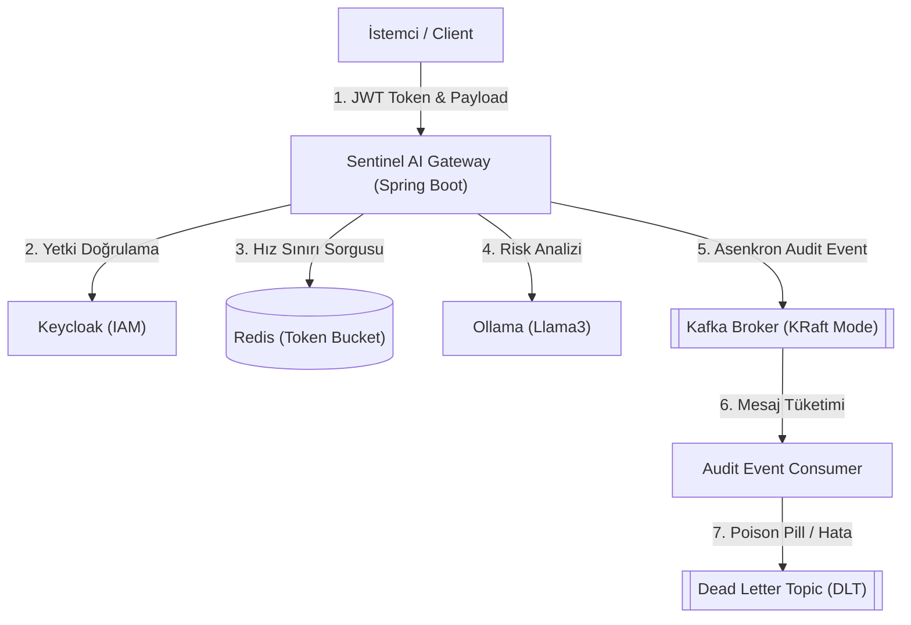
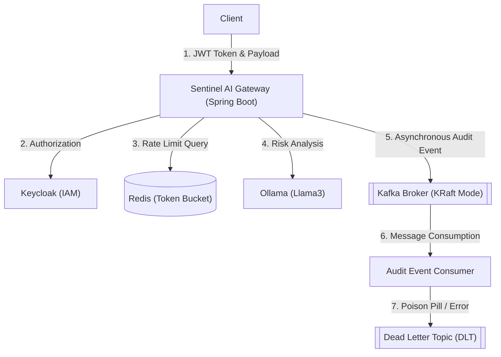
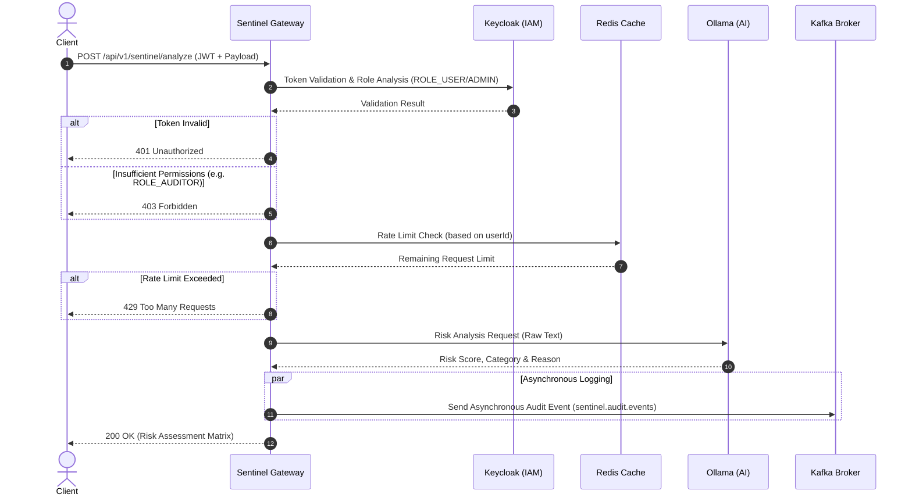

[Türkçe](#türkçe) | [English](#english)

---

<a id="türkçe"></a>
# 🛡️ The Sentinel AI Gateway (TR)

Sentinel AI Gateway, yapay zeka destekli akıllı güvenlik filtresi ve asenkron denetim (audit) geçididir. Gelen veri veya işlem detaylarını yerel bir LLM modeli üzerinden süzgeçten geçirerek dinamik olarak risk analizi gerçekleştirir.

Proje; JWT doğrulamalı mikroservis güvenliği, Redis ile yüksek performanslı hız limitleme (rate limiting), asenkron Kafka mesajlaşması ve yerel yapay zeka (Ollama) katmanlarını bir araya getiren örnek bir kurumsal mimaridir (POC).

---

## 🏛️ Mimari Yapı

Aşağıdaki şemada sistemin katmanları ve bileşenler arası ilişkiler gösterilmiştir:



---

## ⚡ API Akış Senaryosu (Sequence Diagram)

Sisteme gelen bir analiz isteğinin baştan sona izlediği yol aşağıdaki sıralı akış diyagramında detaylandırılmıştır:

```mermaid
sequenceDiagram
    autonumber
    actor Client as İstemci (Client)
    participant GW as Sentinel Gateway
    participant KC as Keycloak (IAM)
    participant Redis as Redis Cache
    participant Ollama as Ollama (AI)
    participant Kafka as Kafka Broker

    Client->>GW: POST /api/v1/sentinel/analyze (JWT + Payload)
    GW->>KC: Token Doğrulama & Rol Analizi (ROLE_USER/ADMIN)
    KC-->>GW: Token Doğrulama Sonucu
    alt Token Geçersizse
        GW-->>Client: 401 Unauthorized
    else Yetki Yetersizse (Örn; ROLE_AUDITOR)
        GW-->>Client: 403 Forbidden
    end

    GW->>Redis: Hız Sınırı Kontrolü (userId tabanlı)
    Redis-->>GW: Kalan İstek Limiti
    alt Hız Limiti Aşıldıysa
        GW-->>Client: 429 Too Many Requests
    end

    GW->>Ollama: Risk Analizi Talebi (Ham Metin)
    Ollama-->>GW: Risk Skoru, Kategori ve Gerekçe
    
    par Asenkron Kayıt
        GW->>Kafka: Asenkron Audit Event Gönder (sentinel.audit.events)
    end

    GW-->>Client: 200 OK (Risk Değerlendirme Matrisi)
```

---

## 🚀 Hızlı Başlangıç & Yerel Kurulum

### Gereksinimler
- Docker ve Docker Compose
- Java 25 (Derleme ve geliştirme için)
- Maven veya `./mvnw`

### 1. Altyapıyı Ayağa Kaldırma
Docker ortamındaki tüm servisleri (Postgres, Keycloak, Redis, Kafka ve Ollama) başlatmak için:
```bash
docker-compose up -d
```

### 2. Yapay Zeka Modelini Hazırlama
Ollama konteyneri ayağa kalktıktan sonra içerisine analiz modelini yüklememiz gerekir:
```bash
docker-compose exec ollama ollama run llama3
```
*(Alternatif olarak daha hafif bir model olan `mistral` veya `gemma` da tercih edilebilir).*

### 3. Uygulamayı Derleme ve Test Etme
Projeyi testleri koşturarak doğrulamak için:
```bash
./mvnw clean verify
```

Uygulamayı yerel ortamda çalıştırmak için:
```bash
./mvnw spring-boot:run
```

---

## 📄 API Dokümantasyonu
API uç noktalarının OpenAPI spesifikasyonu projenin kök dizinindeki [openapi.yaml](file:///Users/birtan/Documents/project/the_sentinel_ai_gateway/poc/openapi.yaml) dosyasında mevcuttur.
- **POST `/api/v1/sentinel/analyze`**: JWT ile yetkilendirilmiş risk analizi yapar.
- **GET `/api/v1/sentinel/admin/health`**: Sadece yöneticilerin erişebildiği sağlık kontrolü servisidir.

---
---

<a id="english"></a>
# 🛡️ The Sentinel AI Gateway (EN)

Sentinel AI Gateway is an AI-powered smart security filter and asynchronous audit gateway. It dynamically performs risk analysis by filtering incoming data or transaction details through a local LLM model.

The project is a proof of concept (POC) that combines JWT-authenticated microservice security, high-performance rate limiting with Redis, asynchronous Kafka messaging, and local AI (Ollama) layers.

---

## 🏛️ Architecture

The diagram below shows the layers of the system and the relationships between components:



---

## ⚡ API Sequence Diagram

The sequence diagram below details the path followed by an incoming analysis request from start to finish:



---

## 🚀 Quick Start & Local Installation

### Prerequisites
- Docker and Docker Compose
- Java 25 (for build and development)
- Maven or `./mvnw`

### 1. Spinning up the Infrastructure
To start all services in the Docker environment (Postgres, Keycloak, Redis, Kafka, and Ollama):
```bash
docker-compose up -d
```

### 2. Preparing the AI Model
Once the Ollama container is up and running, we need to load the analysis model:
```bash
docker-compose exec ollama ollama run llama3
```
*(Alternatively, lighter models like `mistral` or `gemma` can also be preferred).*

### 3. Building and Testing the Application
To verify the project by running tests:
```bash
./mvnw clean verify
```

To run the application locally:
```bash
./mvnw spring-boot:run
```

---

## 📄 API Documentation
The OpenAPI specification of API endpoints is available in the [openapi.yaml](file:///Users/birtan/Documents/project/the_sentinel_ai_gateway/poc/openapi.yaml) file at the root of the project.
- **POST `/api/v1/sentinel/analyze`**: Performs JWT-authenticated risk analysis.
- **GET `/api/v1/sentinel/admin/health`**: Admin-only health check service.
